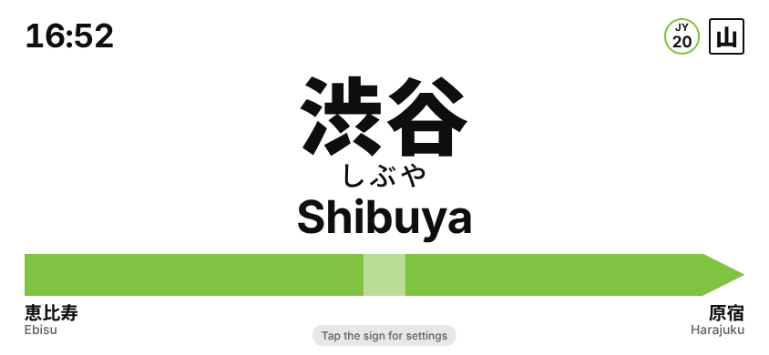

# ekimei 駅名

JR-style station name signs with a live clock, for a desk or bedside iPhone or iPad.



Two ways to use it:

| | What it is | Works in StandBy? |
|---|---|---|
| `web/` | One full-screen HTML page. Add it to the Home Screen, rotate to landscape, keep the screen awake. | No. Behaves like StandBy, but it is a normal page. |
| `ios/` | SwiftUI app plus a WidgetKit widget (small and medium). | Yes. Widgets appear in StandBy like any other. |

## Lines

All data lives in `data/lines.json` and is shared by the web page and the iOS targets.

| Line | Code | Stations |
|---|---|---|
| Yamanote 山手線 | JY | JY01 Tokyo to JY30 Yurakucho (loop) |
| Chūō Rapid 中央線 | JC | JC01 Tokyo to JC12 Mitaka |
| Keihin-Tōhoku 京浜東北線 | JK | JK06 Isogo to JK47 Omiya |
| Chūō-Sōbu 中央・総武線 | JB | JB01 Mitaka to JB39 Chiba |
| Saikyō 埼京線 | JA | JA08 Osaki to JA15 Akabane |
| Tōkaidō 東海道線 | JT | JT01 Tokyo to JT16 Odawara |
| Osaka Loop 大阪環状線 | O | O01 Tennoji to O19 Shin-Imamiya (loop) |
| JR Kyōto / Kōbe 京都線・神戸線 | A | A31 Kyoto to A85 Himeji |
| Yamatoji 大和路線 | Q | Q17 JR Namba to Q39 Kamo (Q35 is unused) |
| Hanwa 阪和線 | R | R20 Tennoji to R54 Wakayama |

Station numbers and kanji for every line were checked against the station tables on English Wikipedia (JR East lines on 2026-11-26, Kansai lines the same day). The hiragana readings were converted to romaji and compared with the verified romaji (one typo fixed, Izumi-Sunagawa). The line colours were added by hand and have not been checked. Fix `data/lines.json` if anything is off. To add a line, append an entry in the same format (`[kanji, kana, romaji, number]` per station), then run `python3 tools/build.py`.

## Web

```bash
python3 tools/build.py        # regenerates web/lines.js from data/lines.json
python3 -m http.server        # then open http://localhost:8000/web/
```

Tap the sign for settings (line, station, direction, ride mode, theme, clock format, custom sign).
`python3 tools/build.py --standalone out.html` writes a single self-contained file.

## iOS (needs a Mac with Xcode 15 or later, iOS 17+)

```bash
brew install xcodegen
xcodegen                      # creates Ekimei.xcodeproj from project.yml
open Ekimei.xcodeproj
```

Before building, set your team and bundle ids (`com.example.ekimei` and `com.example.ekimei.widget` in `project.yml`, or in Xcode).

Then on the device: long-press the Home Screen, add the **Ekimei** widget, long-press it and choose Edit Widget to pick a station, direction, ride mode and appearance. Put the phone in landscape on a charger and StandBy will show it.

Notes on StandBy:

- StandBy shows small widgets, so the small layout is the one that matters. It is a square version of the sign with the station name, band, neighbouring stations and a live clock.
- StandBy removes the widget background and, in Night Mode, tints everything red. The sign switches to black when the background is removed.
- Ride mode pre-computes the next 12 hours of stations as timeline entries, so the sign moves along the line without waking the app.
- The app has a full-screen mode that keeps the display awake, if you want the wide sign instead of a widget.

## Deploy

**Web (GitHub Pages).** In the repo, open Settings, then Pages, set Source to "Deploy from a branch", branch `main`, folder `/ (root)`. The sign is then at `https://<user>.github.io/jr-standby/` (the root page redirects to `web/`). Pages on a free account needs a public repo. On the iPhone or iPad, open that URL in Safari, tap Share, then Add to Home Screen. Launched from the Home Screen it runs full screen with no Safari bar. After editing `data/lines.json`, run `python3 tools/build.py` and commit `web/lines.js` too.

**iOS (device install).** Run `xcodegen`, open the project, pick your team under Signing & Capabilities on both targets, plug in the device and press Run. A free Apple ID works but the install expires after 7 days. For a longer-lived install use a paid developer account and TestFlight.

## Layout

```
data/lines.json            station data for every line (single source of truth)
web/                       HTML page (index.html) and generated lines.js
tools/build.py             generates web/lines.js and an optional standalone page
ios/Ekimei/Shared/         models and the SwiftUI sign view (app and widget)
ios/Ekimei/Widget/         widget, timeline provider and configuration intent
ios/Ekimei/App/            companion app
project.yml                XcodeGen project spec
```
